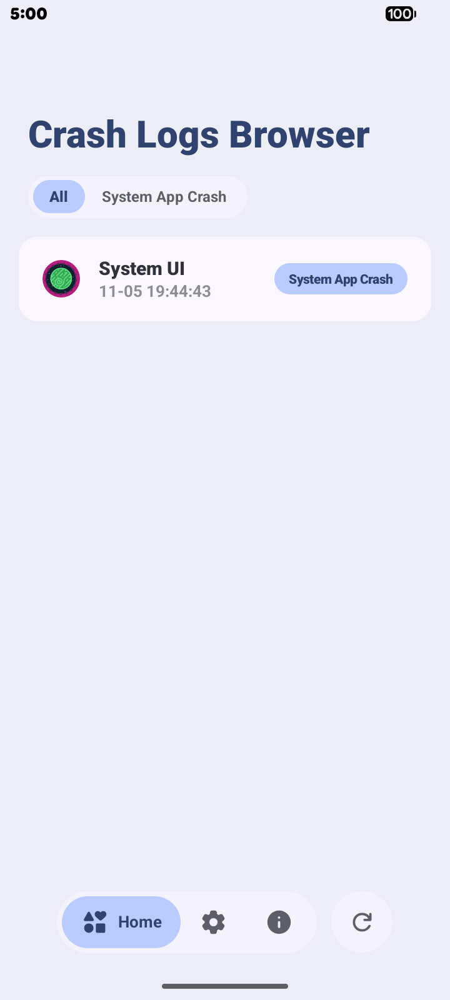
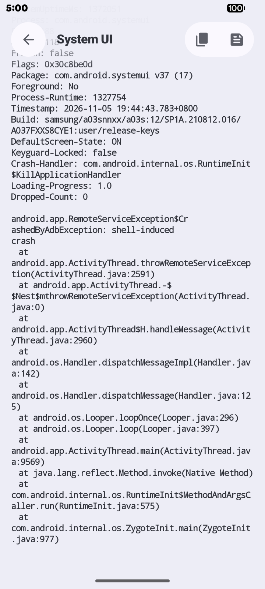
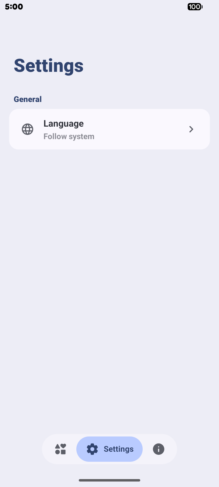
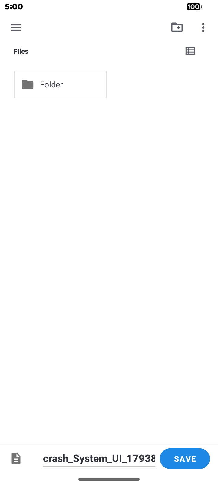

[English](README.md) · **繁體中文**

---

# Crash Logs Browser 

> 一款簡單 / 輕量的 Android 當機與 ANR 日誌檢視器

## 功能

> 檢視當機 (Crash) 與無回應 (ANR) 日誌

> 支援透過 adb 指令或 Root 授予應用程式權限

## 螢幕截圖

  
  
  
  

## 下載

從 [Releases 頁面](https://github.com/HeheJuice/Crash-Logs-Browser/releases) 下載最新的 APK。

## 開源

本專案為**開源軟體**，並依據 [GPL-3.0 授權條款](LICENSE) 發布。

## 授權與隱私

> [授權條款 (GPL-3.0)](LICENSE)
>
> [隱私權政策](Privacy_Policy.txt)

> [!NOTE]
> 當您使用或轉發此內容時，即表示您同意並遵守這些條款。

## 致謝

<table>
  <tbody>
    <tr>
      <td width="56" align="center" valign="middle">
        
      </td>
      <td valign="middle">
        <a href="https://github.com/HeheJuice"><b>HeheJuice</b></a> 
        本應用程式開發者
      </td>
    </tr>
    <tr>
      <td width="56" align="center" valign="middle">
        
      </td>
      <td valign="middle">
        <a href="https://github.com/MiToverG422"><b>MiToverG422</b></a> 
        Monet 取色協助
      </td>
    </tr>
    <tr>
      <td width="56" align="center" valign="middle">
        
      </td>
      <td valign="middle">
        <a href="https://github.com/material-components"><b>Material Components</b></a> 
        本應用程式使用的 Material Design 元件
      </td>
    </tr>
    <tr>
      <td width="56" align="center" valign="middle">
        
      </td>
      <td valign="middle">
        <a href="https://github.com/google"><b>Google</b></a> 
        本應用程式使用的 Material Design 圖示
      </td>
    </tr>
  </tbody>
</table>

## 加入我們
